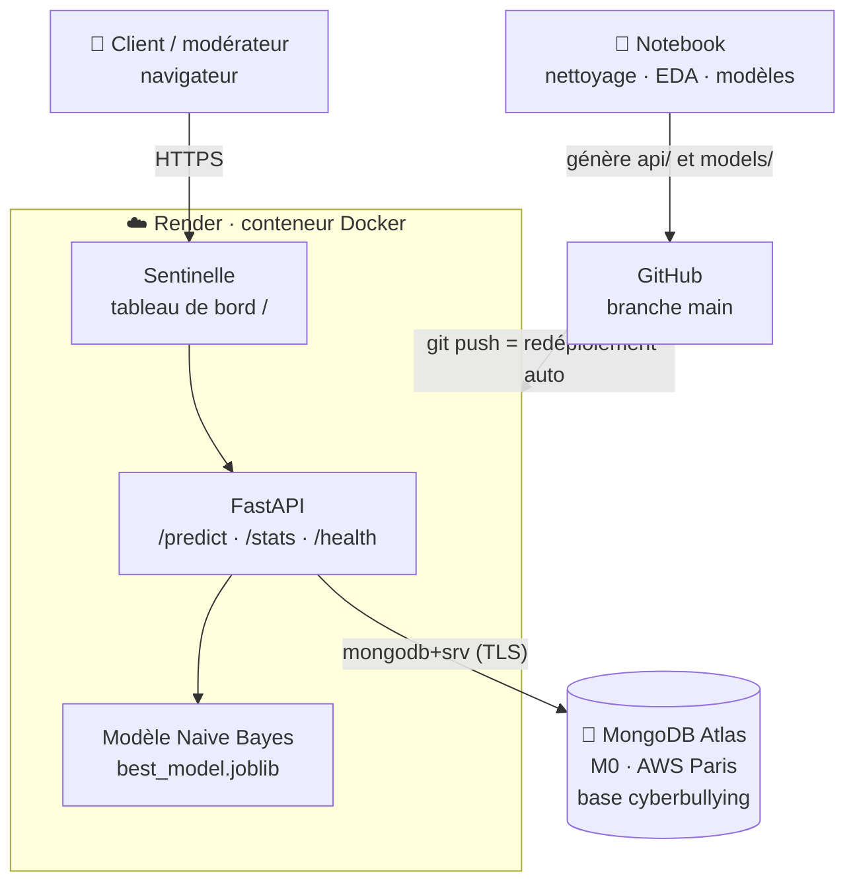
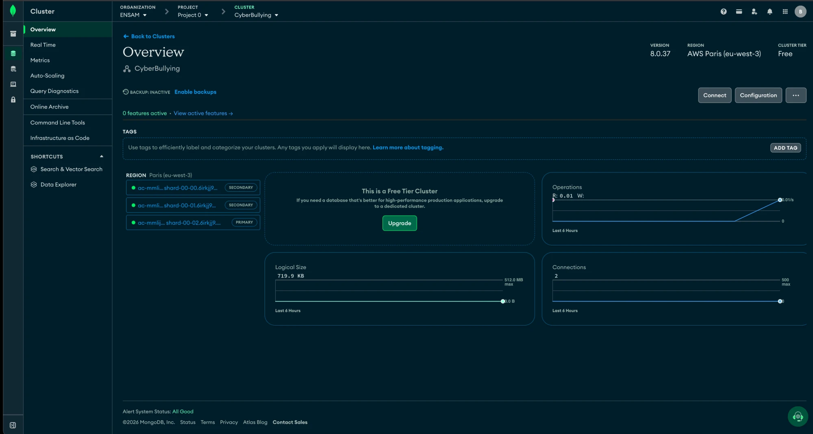
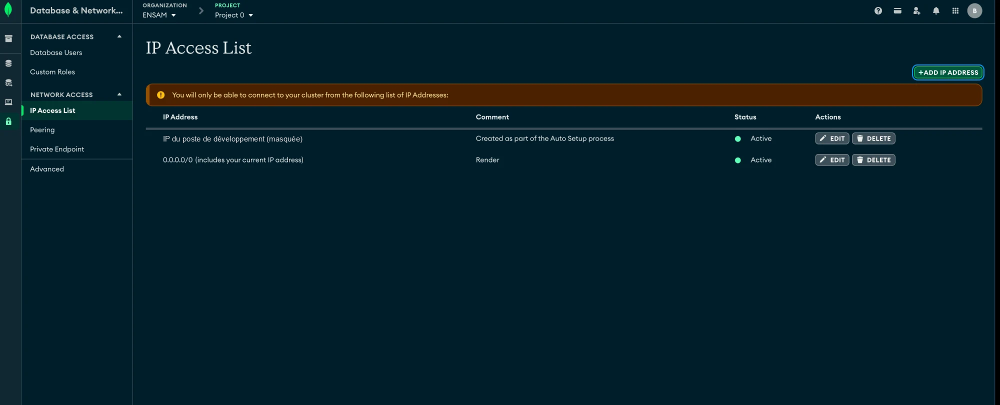

<p align="center">
  
</p>

<p align="center">
  <b>Détection automatique du harcèlement sur les réseaux sociaux</b><br>
  Test Data Science · Notebook complet · API FastAPI · MongoDB · Docker · Déployé sur Render
</p>

<p align="center">
  <a href="https://sentinelle-cyberbullying.onrender.com"></a>
  <a href="https://sentinelle-cyberbullying.onrender.com/docs"></a>
  
  
</p>

---

## Sommaire

1. [Démo en ligne](#démo-en-ligne)
2. [Sentinelle, le tableau de bord](#sentinelle-le-tableau-de-bord)
3. [Architecture](#architecture)
4. [Le notebook (étapes 1 à 8 du test)](#le-notebook-étapes-1-à-8-du-test)
5. [MongoDB](#mongodb)
6. [API](#api)
7. [Exécution en local](#exécution-en-local)
8. [Déploiement (Render + MongoDB Atlas)](#déploiement-render--mongodb-atlas)
9. [Logs, supervision et dépannage](#logs-supervision-et-dépannage)
10. [Résultats](#résultats-étude-comparative)

---

## Démo en ligne

| | Lien |
|---|---|
| **Sentinelle**, tableau de bord pour le client et les modérateurs | **https://sentinelle-cyberbullying.onrender.com** |
| **Documentation API** (Swagger, pour les développeurs) | https://sentinelle-cyberbullying.onrender.com/docs |
| **État du service** | https://sentinelle-cyberbullying.onrender.com/health |
| **Analyse partageable** (message dans l'URL) | https://sentinelle-cyberbullying.onrender.com/?q=I%20will%20find%20you%20and%20kill%20you |

> ⏱️ Offre gratuite Render : après 15 minutes sans visite, le service se met en veille. La première ouverture prend alors environ 50 secondes.

---

## Sentinelle, le tableau de bord

Sentinelle est l'interface destinée aux utilisateurs non techniques : modérateurs ou client. Elle est servie par l'API à l'adresse `/`.


| Fonction | Détail |
|---|---|
| **Analyse d'un message** | score de risque de 0 à 100 (jauge), verdict *Signalé* / *Conforme*, niveau de risque, **termes déterminants** et recommandation d'action |
| **Analyse par lot** | un message par ligne (jusqu'à 1 000), synthèse analysés / signalés / conformes, tableau trié par score, **export CSV** |
| **Historique** | les 8 dernières analyses de la session |
| **Données d'apprentissage** | indicateurs clés (volume, F1, rappel) et graphiques par catégorie, lus en direct dans MongoDB |
| **Lien partageable** | `/?q=<message>` pré-remplit le message et lance l'analyse ; `/?mode=many&q=...` fait de même en mode lot |

<details>
<summary><b>Autres captures</b> (lot de messages, message sain)</summary>


</details>

**Technologies** : Bootstrap 5.3, Bootstrap Icons, Chart.js 4, police Inter. Mode sombre automatique, responsive mobile, accessibilité (navigation clavier, annonces pour lecteurs d'écran, contrastes AA). Le code se trouve dans `api/static/` (`index.html`, `app.css`, `app.js`, `theme.js`).

---

## Architecture



- **Le modèle tourne dans le conteneur.** Les prédictions ne dépendent pas de MongoDB : si la base est indisponible, `/predict` continue de répondre.
- **MongoDB** stocke le jeu de données nettoyé (pour `/stats` et les graphiques) et l'historique de toutes les prédictions.

---

## Le notebook (étapes 1 à 8 du test)

**Tout le projet est dans un seul notebook : [`cyberbullying_detection.ipynb`](cyberbullying_detection.ipynb)**. Il est déjà exécuté : les résultats et graphiques sont visibles directement sur GitHub.

| Section | Contenu |
|---|---|
| 1. Exploration et nettoyage | 19 orthographes du label → 2 classes, 24 types → 7, doublons et labels contradictoires supprimés (8 452 → 5 760 messages) |
| 2. MongoDB | chargement dans `cyberbullying.messages`, index, agrégations |
| 3. Analyse descriptive | classes, types de harcèlement, longueur, grossièretés, vocabulaire (données relues depuis MongoDB) |
| 4. Modélisation | Régression logistique vs Naive Bayes (TF-IDF), validation croisée 5 folds |
| 5. Étude comparative | métriques, test de McNemar, taux de détection par type |
| 6. Visualisations | matrices de confusion, ROC / Précision-Rappel, facteurs influents, analyse d'erreurs |
| 7. FastAPI + Docker | export du modèle, code de l'API et de Sentinelle, build et test du conteneur, captures de l'interface |
| 8. Conclusion | choix du modèle, limites, pistes |

Le notebook écrit lui-même les fichiers de l'API (`%%writefile`) : il n'y a qu'une seule source de code.

Données : [Kaggle – Cyberbullying and Harassment Detection using ML](https://www.kaggle.com/datasets/saifulislam7/cyberbullying-and-harassment-detection-using-ml).

```
├── cyberbullying_detection.ipynb   # le projet complet (étapes 1 → 8)
├── data/                           # raw_cyberbullying.csv (Kaggle) + clean_cyberbullying.csv (généré)
├── models/                         # best_model.joblib + metadata.json (générés)
├── figures/                        # graphiques, captures de Sentinelle, logo
├── api/                            # app.py, text_utils.py, requirements.txt, static/ (Sentinelle) – générés
├── Dockerfile                      # image de l'API
├── docker-compose.yml              # MongoDB + API en local
├── render.yaml                     # déploiement Render (Blueprint)
└── requirements.txt                # environnement du notebook
```

---

## MongoDB

### Cluster en production (MongoDB Atlas)

Cluster **CyberBullying** : offre gratuite M0, MongoDB 8.0, **AWS Paris (eu-west-3)**, replica set de 3 nœuds (1 primaire, 2 secondaires). Après le premier démarrage de l'API, la base contient environ **720 Ko** de données : les 5 760 messages et l'historique des prédictions.



**Accès réseau** : l'entrée `0.0.0.0/0` (commentaire *Render*) autorise le service Render, dont l'adresse IP n'est pas fixe sur l'offre gratuite. La base reste protégée par l'utilisateur et le mot de passe contenus dans `MONGO_URI`.



### Base et collections

| | Local (Docker) | Production |
|---|---|---|
| Serveur | `mongo:7` (service `mongo` du `docker-compose.yml`) | **MongoDB Atlas**, cluster M0 gratuit, AWS Paris (eu-west-3) |
| Connexion | `mongodb://localhost:27017` | `mongodb+srv://<user>:<password>@cyberbullying.xxxxx.mongodb.net` |
| Base | `cyberbullying` | `cyberbullying` |

| Collection | Rôle | Écrite par | Lue par |
|---|---|---|---|
| `messages` | les **5 760 messages nettoyés** du jeu de données | le notebook (section 2) ; l'API au démarrage si la collection est vide | notebook (section 3), `/stats`, graphiques de Sentinelle |
| `predictions` | **historique de chaque prédiction** faite par l'API (journal des analyses) | `/predict`, `/predict/batch` | supervision, analyse de dérive |

### Structure d'un document

**`messages`**
```json
{
  "text": "I will find you and kill you",
  "clean_text": "i will find you and kill you",
  "label": 1,
  "label_name": "Bullying",
  "type": "Threat",
  "char_len": 28,
  "word_count": 7,
  "upper_ratio": 0.0357,
  "n_exclam": 0,
  "n_question": 0,
  "has_profanity": 0
}
```
`type` ∈ `Troll`, `Sexual`, `Vocational`, `Political`, `Religion`, `Threat`, `Ethnicity`, `Unspecified` (harcèlement) ou `No-Harassment`.

**`predictions`**
```json
{
  "text": "you are a worthless idiot",
  "label": "Bullying",
  "is_bullying": true,
  "probability_bullying": 0.9875,
  "key_words": ["idiot", "worthless"],
  "at": "2026-11-06T15:20:41Z"
}
```

### Index (créés par le notebook)
- `label` et `type` : filtres et regroupements rapides ;
- index **texte** sur `clean_text` : recherche plein texte (`$text`).

### Agrégation utilisée par `/stats`
```js
db.messages.aggregate([
  { $match: { label: 1 } },
  { $group: { _id: "$type", n: { $sum: 1 }, avg_words: { $avg: "$word_count" } } },
  { $sort: { n: -1 } }
])
```

### Requêtes utiles (mongosh ou *Data Explorer* d'Atlas)
```js
use cyberbullying
db.messages.countDocuments({ label: 1 })                         // nombre de messages de harcèlement
db.messages.find({ $text: { $search: "kill" } }).limit(5)        // recherche plein texte
db.predictions.find().sort({ at: -1 }).limit(10)                 // 10 dernières analyses
db.predictions.aggregate([{ $group: { _id: "$is_bullying", n: { $sum: 1 } } }])  // taux de signalement
```

### Remplissage automatique
Au démarrage, l'API vérifie la collection `messages`. Si elle est vide (nouvelle base Atlas), elle y charge `data/clean_cyberbullying.csv`, qui est inclus dans l'image Docker. Si la base n'était pas joignable au démarrage, le chargement se fait au premier appel de `/stats`. **Aucune étape manuelle n'est nécessaire.**

---

## API

| Endpoint | Méthode | Rôle |
|---|---|---|
| `/` | GET | tableau de bord **Sentinelle** |
| `/predict` | POST | `{"text": "..."}` → label, probabilité, termes déterminants |
| `/predict/batch` | POST | `{"texts": [...]}` (≤ 1000) |
| `/stats` | GET | répartition par classe et par type (agrégations MongoDB) |
| `/model` | GET | modèle retenu et métriques de test |
| `/health` | GET | état de l'API, du modèle et de la connexion MongoDB |
| `/docs` | GET | documentation interactive Swagger |

```bash
curl -X POST https://sentinelle-cyberbullying.onrender.com/predict \
     -H "Content-Type: application/json" -d '{"text":"you are a worthless idiot"}'
# {"label":"Bullying","is_bullying":true,"probability_bullying":0.9875,"key_words":["idiot","worthless"], ...}
```

---

## Exécution en local

Prérequis : Python 3.12+ et Docker Desktop lancé.

**Tout le projet (notebook)**
```bash
python3 -m venv .venv && source .venv/bin/activate
pip install -r requirements.txt
jupyter lab cyberbullying_detection.ipynb     # puis « Run All »
```

**Uniquement l'API et Sentinelle** (modèle déjà entraîné)
```bash
docker compose up -d --build
```
Ouvrir http://localhost:8000 pour Sentinelle, ou http://localhost:8000/docs pour l'API. Arrêt : `docker compose down` (ajouter `-v` pour supprimer les données MongoDB).

---

## Déploiement (Render + MongoDB Atlas)

Le service est décrit dans [`render.yaml`](render.yaml) (Blueprint). Render construit le `Dockerfile` depuis GitHub et **redéploie automatiquement à chaque `git push` sur `main`**.

### Variables d'environnement

| Variable | Où | Valeur |
|---|---|---|
| `MONGO_URI` | Render → service → **Environment** | chaîne de connexion Atlas `mongodb+srv://...` |
| `PORT` | fournie par Render | port d'écoute (8000 par défaut en local) |

> 🔐 La chaîne de connexion contient le mot de passe de la base. Elle se renseigne **uniquement dans Render**, jamais dans le code ni sur GitHub. Le `.gitignore` bloque les fichiers `.env` et `*credentials*`.

### Mise en place (une seule fois)

1. **MongoDB Atlas** (https://cloud.mongodb.com)
   - Créer un cluster gratuit **M0** (ici AWS Paris), sans le *sample dataset*.
   - **Security → Database Access** : créer un utilisateur avec un mot de passe généré.
   - **Security → Network Access** : autoriser `0.0.0.0/0`, car Render (offre gratuite) n'a pas d'IP fixe.
   - **Connect → Drivers** : copier la chaîne `mongodb+srv://...` et y mettre le mot de passe.
2. **Render** (https://render.com, connexion avec GitHub)
   - **New → Blueprint**, puis choisir ce dépôt (le fichier `render.yaml` est détecté).
   - Coller la chaîne Atlas dans `MONGO_URI`, puis cliquer sur **Deploy Blueprint**.
3. Ouvrir l'URL du service. Au premier démarrage, l'API remplit la base Atlas avec les 5 760 messages.

### Mettre à jour
```bash
git add -A && git commit -m "..." && git push    # Render reconstruit et redéploie (≈ 5 min)
```

### Autres plateformes
L'image est autonome (modèle et données inclus) et sans état : elle fonctionne sur Azure Container Apps, AWS ECS, Google Cloud Run ou Kubernetes en fournissant `MONGO_URI`.
```bash
docker build -t <registre>/sentinelle:1.0 . && docker push <registre>/sentinelle:1.0
docker run -d -p 8000:8000 -e MONGO_URI="mongodb+srv://..." <registre>/sentinelle:1.0
```

---

## Logs, supervision et dépannage

### Où trouver les logs

| Quoi | Où |
|---|---|
| **Logs de build et d'exécution** (requêtes HTTP, démarrage, erreurs) | Render → service `sentinelle-cyberbullying` → **Logs** |
| **Historique des déploiements** | Render → service → **Events** |
| **État en direct** | `GET /health` → `{"status":"ok","model":"Naive Bayes","mongo":"up"}` |
| **Activité de la base** (connexions, opérations) | Atlas → cluster → **Metrics** |
| **Journal des prédictions** | collection `predictions` (Atlas → **Browse Collections**) |
| **En local** | `docker compose logs -f api` |

Exemples de lignes de log Render :
```
INFO:     Uvicorn running on http://0.0.0.0:10000
INFO:     Application startup complete.
INFO:     10.0.0.1:0 - "POST /predict HTTP/1.1" 200 OK
MongoDB seeding skipped: <erreur>      ← la base n'était pas joignable au démarrage
```

### Dépannage

| Symptôme | Cause probable | Solution |
|---|---|---|
| `/health` → `"mongo": "down"`, erreur `SSL handshake failed` / `TLSV1_ALERT_INTERNAL_ERROR` | l'IP de Render n'est pas autorisée dans Atlas | Atlas → **Network Access** → ajouter `0.0.0.0/0` |
| `bad auth : authentication failed` | mauvais mot de passe dans `MONGO_URI` | vérifier la chaîne dans Render → Environment, puis **Save** (redéploiement) |
| Graphiques vides dans Sentinelle | MongoDB injoignable | voir les deux lignes ci-dessus ; les données se chargent seules ensuite |
| Première page très lente | service en veille (offre gratuite) | attendre environ 50 secondes ; ouvrir le lien juste avant une démo |
| Échec du déploiement | erreur de build | Render → **Logs** : lire les dernières lignes |

---

## Résultats (étude comparative)

| Métrique (test, n = 1 152) | Régression logistique | Naive Bayes ✅ |
|---|---|---|
| F1 | 0,916 | **0,920** |
| ROC-AUC | 0,968 | **0,973** |
| Rappel (Bullying) | 0,927 | **0,941** |
| Précision (Bullying) | **0,905** | 0,900 |
| F1 en CV 5 folds | 0,911 ± 0,007 | **0,914 ± 0,007** |
| Vitesse | | **≈ 5-7× plus rapide** |

Test de McNemar : p = 0,71, donc la différence n'est pas significative. **Naive Bayes** est retenu pour son meilleur rappel (un harcèlement manqué coûte plus cher qu'une fausse alerte) et sa rapidité. La régression logistique reste la plus interprétable. La catégorie **Troll** est la plus difficile (≈ 86 % détectés). Le détail complet est dans les sections 5, 6 et 8 du notebook.
